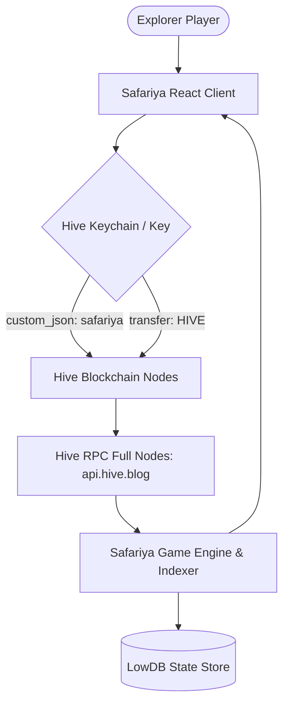

# 🌍 SAFARIYA: Africa Explorer

[](https://hive.io)
[](https://opensource.org/licenses/MIT)
[](https://safariya-africa-explorer.fly.dev)
[](https://hive.io/eco/)

> **Safariya: Africa Explorer** is a cutting-edge, Web3 trading card & territory adventure game built on the **Hive blockchain**, inspired by Splinterlands. Journey across 5 majestic African regions, collect 8 legendary African Explorer NFT cards, conquer 10 historic territories, and earn real **HIVE** cryptocurrency rewards with **zero gas fees** and **3-second block finality**.

---

## 🌟 Quick Links & Project Metadata

| Item | Details & Link |
| :--- | :--- |
| **Final Project Name** | **Safariya: Africa Explorer** |
| **Tagline** | The Premier African Adventure Trading Card Game on Hive |
| **Description** | Web3 trading card & territory adventure game powered by Hive blockchain. Explore Africa, collect legendary warrior cards, battle for territories, and earn HIVE rewards. |
| **Live Project URL** | [https://safariya-africa-explorer.fly.dev](https://safariya-africa-explorer.fly.dev) |
| **Repository URL** | [https://github.com/peddipedderu/safariya](https://github.com/peddipedderu/safariya) |
| **Announcement Post URL** | [https://hive.blog/hive-133987/@peddipedderu/introducing-safariya-africa-explorer-a-cutting-edge-hive-blockchain-game](https://hive.blog/hive-133987/@peddipedderu/introducing-safariya-africa-explorer-a-cutting-edge-hive-blockchain-game) |
| **Contact URL** | [https://hive.blog/@peddipedderu](https://hive.blog/@peddipedderu) / [https://github.com/peddipedderu](https://github.com/peddipedderu) |
| **OpenHive.chat Channel** | `#safariya` on [openhive.chat](https://openhive.chat/channel/safariya) |
| **Community Discord** | [Hive Official Discord](https://discord.gg/hive) |
| **Team Members** | **@peddipedderu** (Founder & Lead Developer) |
| **Blockchain** | **Hive Mainnet** (`custom_json` operations, transfers, zero gas) |
| **Hive Ecosystem Category** | **Games & Entertainment** (`https://hive.io/eco/`) |

---

## 🎮 Gameplay Features

### 1. 🃏 African Explorer NFT Cards
Eight meticulously designed explorer cards celebrating Africa's history, bravery, and natural lore:
- **Maasai Warrior** (Common · Earth) - *Spear Throw* (ATK: 3, DEF: 2, SPD: 4, HP: 8)
- **Sahara Nomad** (Common · Fire) - *Sand Veil* (ATK: 2, DEF: 3, SPD: 5, HP: 7)
- **Congo Shaman** (Rare · Nature) - *Jungle Hex* (ATK: 5, DEF: 2, SPD: 3, HP: 10)
- **Nile Priestess** (Rare · Water) - *Flood Blessing* (ATK: 4, DEF: 4, SPD: 3, HP: 12)
- **Kilimanjaro Titan** (Epic · Wind) - *Mountain Roar* (ATK: 7, DEF: 5, SPD: 2, HP: 18)
- **Serengeti Queen** (Epic · Earth) - *Great Migration* (ATK: 6, DEF: 6, SPD: 5, HP: 20)
- **Sphinx Guardian** (Legendary · Fire) - *Ancient Riddle* (ATK: 10, DEF: 8, SPD: 4, HP: 30)
- **Ubuntu Elder** (Legendary · Nature) - *Unity Shield* (ATK: 8, DEF: 10, SPD: 3, HP: 35)

### 2. 🗺️ Territory Conquest Across 5 African Regions
Battle and hold strategic landmarks across Africa:
- **North Africa**: Sahara Desert (Lv. 1), Nile Delta (Lv. 1)
- **East Africa**: Mt. Kilimanjaro (Lv. 3), Serengeti Plains (Lv. 2), Great Rift Valley (Lv. 4), Lake Victoria (Lv. 3)
- **Central Africa**: Congo Rainforest (Lv. 2)
- **Southern Africa**: Kalahari Basin (Lv. 2), Cape of Good Hope (Lv. 5)
- **Indian Ocean**: Madagascar Isle (Lv. 5)

### 3. ⚔️ Splinterlands-Style Battle Mechanics
- Team assembly of 1–3 explorer cards.
- Strategic elemental advantages: `Fire` 🔥, `Water` 💧, `Earth` 🌍, `Wind` 💨, `Nature` 🌿.
- Turn-based damage calculations with special ability activations.
- Dynamic reward pool: Earn XP and real **HIVE** upon winning.

### 4. 🏪 Decentralized P2P Marketplace
- Buy and sell Explorer cards using HIVE.
- Automated escrow verification via Hive transfer memo parsing.
- Real-time market sales tracker and price floor discovery.

### 5. 🔐 Dual Authentication: Hive Keychain & Private Keys
- **Hive Keychain Extension**: Seamless one-click login and signature prompt.
- **Posting Key Fallback**: Direct login using Posting Key for mobile or standalone clients.

---

## ⛓️ Hive Blockchain Integration Architecture

All state actions leverage Hive's battle-tested infrastructure:



### Custom JSON Operations Schema:
- **Game Operation ID**: `safariya`
- **Actions**:
  - `battle_start`: Team composition, territory ID, client timestamp.
  - `territory_claim`: Winning proof, block number, territory captured.
  - `card_trade`: Listing and purchase broadcast operations.

---

## 🚀 Local Development & Setup

### Prerequisites
- Node.js >= 18.0.0
- npm >= 9.0.0

### Installation & Run

```bash
# 1. Clone repository
git clone https://github.com/peddipedderu/safariya.git
cd safariya

# 2. Install backend dependencies
npm install

# 3. Install and build frontend
cd client
npm install
npm run build
cd ..

# 4. Start production server
npm start
# The game will be running on http://localhost:8080
```

---

## 🐳 Docker & Fly.io Deployment

The project includes an optimized multi-stage Docker build:

```bash
# Build Docker image
docker build -t safariya .

# Run container
docker run -p 8080:8080 safariya

# Deploy to Fly.io
fly launch --name safariya-africa-explorer
fly deploy
```

---

## 📜 License
This project is open-source under the [MIT License](LICENSE).
Built with passion for the Hive community and the wonders of Africa. 🌍🦁
